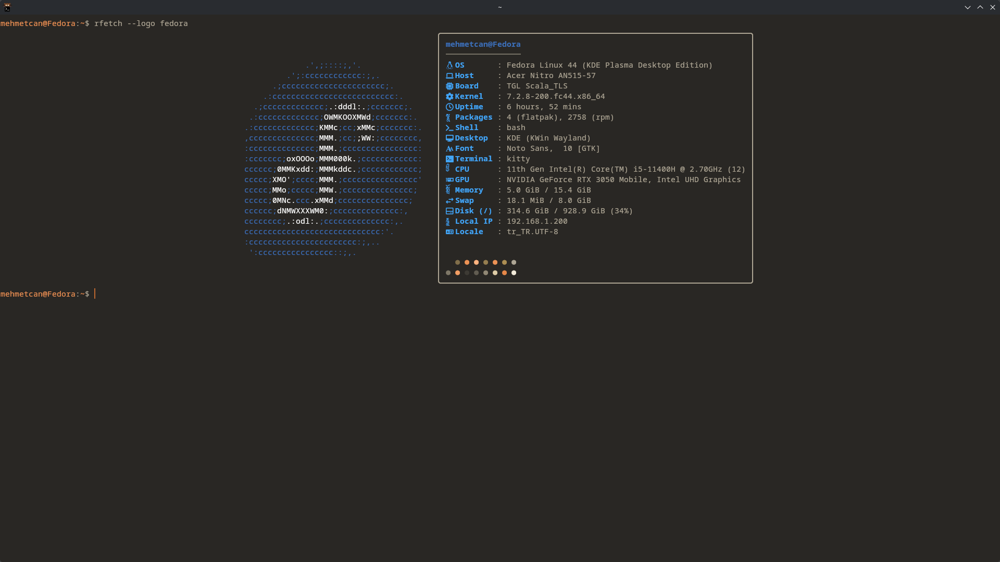
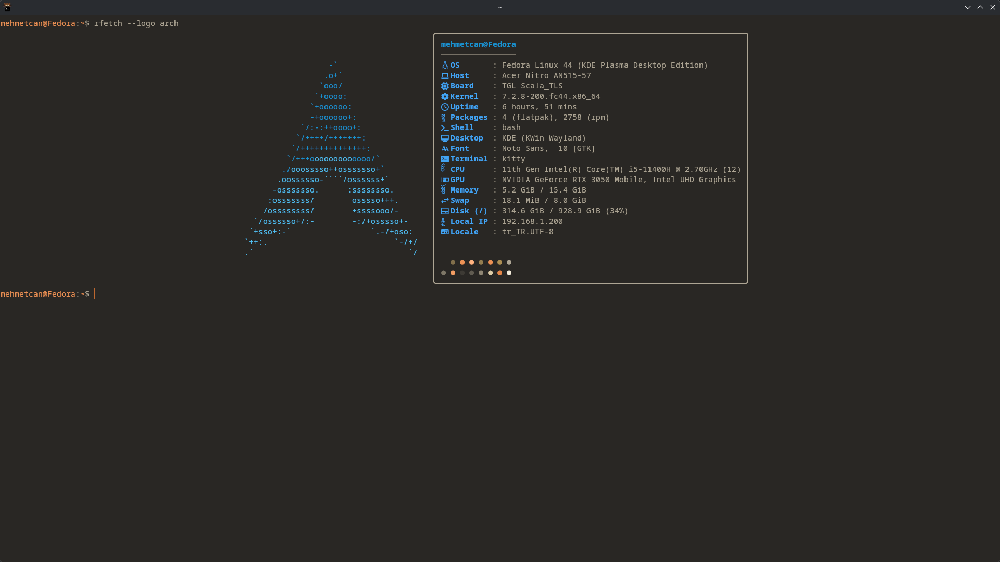
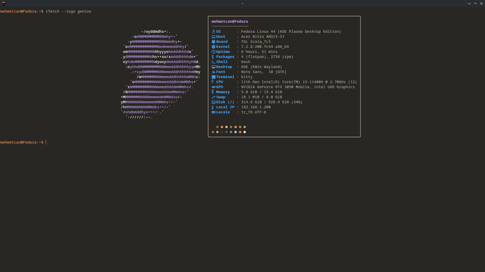

<div align="center">

# 🦀 RustFetch (`rfetch`)

**Blazing-fast (~4ms), memory-safe, zero-fork Linux system fetch & hardware telemetry tool written in pure Rust.**

[](https://github.com/MehmetCanWT/rustfetch/actions/workflows/ci.yml)
[](https://github.com/MehmetCanWT/rustfetch/releases)
[](LICENSE)
[](https://github.com/MehmetCanWT/rustfetch)

</div>

---

## ✨ Why RustFetch?

**RustFetch** (`rustfetch` / `rfetch`) is built from the ground up in Rust to replace slow shell-script fetchers and fragile C configs with a single static-friendly binary that starts in **~4 milliseconds**:

- ⚡ **Zero-Fork Kernel Telemetry (`~4ms`)**: Reads hardware topology directly from `/proc`, `/sys/bus/pci/devices`, `/sys/class/drm` (pure-Rust EDID binary parser), `/sys/class/hwmon`, `/sys/class/power_supply`, and `statx`/`statvfs` syscalls.
- 🖼️ **True Terminal Graphics (`Kitty`, `Sixel`, `Halfblock`)**: Renders crisp PNG/JPG/WebP/GIF artwork with automatic dominant-color & 16-color palette extraction (`.color` sidecar cache), aspect-ratio fitting, and atomic **Kitty Synchronized Output (`?2026h`)** on window resize.
- 🧊 **Real-Time 3D Spinning ASCII Relief (`--3d`)**: Extrudes any built-in distro logo or custom ASCII file into a 3D mesh with Blinn-Phong lighting and sub-cell `ascii`, `blocks`, `braille`, or `sextants` rasterization. Press **any key** or run any command and it **instantly falls back to the static 2D ASCII logo** of the same distro without eating your keystrokes.
- 📈 **Interactive Live Monitor (`--live`) & TUI Config Builder (`--setup`)**: Real-time CPU/RAM Unicode sparkline graphs (`▁▂▃▄▅▆▇█`) with hot-swappable themes, plus an interactive terminal UI to toggle modules, themes, and presets with automatic `.bak` config backups.
- 🛡️ **Non-Destructive Config & Shell Resize Sync (`--install-hook`)**: Never overwrites your existing `~/.config/rustfetch/config.toml`. Shell startup integration automatically redraws and re-centers `rustfetch` when you resize a fresh terminal window before running your first command.
- 🐾 **Self-Updating with Cat Breed Codenames (`--self-update`)**: Built-in cached GitHub release checker (6h TTL) with clickable OSC 8 terminal links and atomic in-place binary updates (`v0.1.0 "Turkish Van"`, `v0.1.1 "Turkish Angora"`, `v0.1.2 "Bengal"`, `v0.1.3 "Maine Coon"`, `v0.1.4 "Siamese"`).

---

## 📸 Screenshots & Showcase

### Example Configurations

<p align="center">
  
</p>

| Example Configuration 2 | Example Configuration 3 |
| :---: | :---: |
|  |  |

### Distro Logos

| Fedora Linux | Arch Linux | Gentoo Linux |
| :---: | :---: | :---: |
|  |  |  |

---

## 🚀 Installation

### 1. Universal One-Liner (`install.sh`)
Automatically detects your Linux distro (Arch, Fedora, Bazzite / `rpm-ostree`, Debian/Ubuntu, NixOS, openSUSE, Alpine, Void, Homebrew), installs `rustfetch` and `rfetch`, man pages, shell completions (`bash`, `zsh`, `fish`), and optional shell startup hooks:

```bash
curl -fsSL https://raw.githubusercontent.com/MehmetCanWT/rustfetch/main/install.sh | bash
```

### 2. Prebuilt Distro Packages (GitHub Releases)
Download native packages directly from the [**Releases**](https://github.com/MehmetCanWT/rustfetch/releases/latest) page:

| Distro / Platform | Artifact Format | Install Command |
| :--- | :--- | :--- |
| **Arch / CachyOS / EndeavourOS** | `rustfetch-v*-arch-x86_64.pkg.tar.zst` | `sudo pacman -U rustfetch-v*-arch-x86_64.pkg.tar.zst` |
| **Fedora / Bazzite / Nobara / RHEL** | `rustfetch-v*-fedora-x86_64.rpm` | `sudo dnf install ./rustfetch-v*-fedora-x86_64.rpm` *(or `rpm-ostree install`)* |
| **Debian / Ubuntu / Pop!_OS / Mint** | `rustfetch-v*-debian-x86_64.deb` | `sudo apt install ./rustfetch-v*-debian-x86_64.deb` |
| **NixOS / Nix Flakes** | `flake.nix` / `nixos-x86_64.tar.gz` | `nix run github:MehmetCanWT/rustfetch` |
| **Generic Linux (`glibc` / `musl` / `aarch64`)** | `rustfetch-v*-linux-*.tar.gz` | Extract `rustfetch` & `rfetch` to `~/.local/bin/` |

### 3. Build from Source (`cargo`)
```bash
git clone https://github.com/MehmetCanWT/rustfetch.git
cd rustfetch
cargo build --workspace --release
install -Dm755 target/release/rustfetch ~/.local/bin/rustfetch
install -Dm755 target/release/rfetch ~/.local/bin/rfetch
```

---

## 🛠️ Quick Start & Everyday Commands

Both `rustfetch` and the shorthand alias `rfetch` accept the same flags:

```bash
# Standard run (uses ~/.config/rustfetch/config.toml)
rustfetch

# Interactive TUI Configuration Builder (toggle modules, presets & themes live)
rustfetch --setup

# System & Terminal Capability Diagnostics (checks Kitty/Sixel, Nerd Fonts, sysfs/procfs, config)
rustfetch --doctor

# Update RustFetch in-place to the latest GitHub Release
rustfetch --self-update

# Live Hardware Monitor with real-time CPU & RAM sparklines ([t] Theme, [b] Border, [q] Quit)
rustfetch --live

# 3D Spinning ASCII Relief Mode (instantly drops to 2D static ASCII on any keypress)
rustfetch --3d
rustfetch --3d -l cachyos --shading-mode braille

# Try presets, themes, and custom logos on the fly
rustfetch --preset card --theme catppuccin
rustfetch -l bazzite --border --border-style rounded
rustfetch -i ~/Pictures/logo.png --protocol kitty

# Discover all built-in modules, distros, themes, and presets
rustfetch --list-modules
rustfetch --list-logos
rustfetch --list-themes
rustfetch --list-presets

# Install or remove shell startup & window-resize hook (.bashrc / .zshrc / config.fish)
rustfetch --install-hook
rustfetch --remove-hook

# Profile microsecond latency of every active collector
rustfetch --benchmark
```

---

## 📊 Telemetry Modules (31 Built-in Collectors)

Run `rustfetch --list-modules` at any time to inspect all collectors. Full schema details are in [**docs/08-modules-and-icons.md**](docs/08-modules-and-icons.md).

| Module | Label | Data Source & Highlights |
| :--- | :--- | :--- |
| `os` | **OS** | `/etc/os-release` with distro-specific Nerd Font v3 glyph (`󰣇`, `󰣛`, ``, `󰕈`, `󱄅`, etc.) |
| `os_age` | **OS Age** | Root `/` filesystem birth timestamp via Linux `statx(STATX_BTIME)` (`42 days, 5 hours`) |
| `host` | **Host** | `/sys/class/dmi/id/product_name` & `product_version` |
| `board` | **Board** | `/sys/class/dmi/id/board_vendor` & `board_name` |
| `kernel` | **Kernel** | Direct `libc::uname` syscall (`sysname`, `release`, `machine`) |
| `uptime` | **Uptime** | `/proc/uptime` formatted into days, hours, and minutes |
| `packages` | **Packages** | Native filesystem counters for `pacman`, `rpm`, `dpkg`, `flatpak`, `brew`, `nix`, `apk`, `xbps`, `emerge`, `snap` |
| `shell` | **Shell** | Active user shell from `$SHELL` / parent process |
| `desktop` | **Desktop** | Desktop Environment & Wayland/X11 Window Manager (`KDE`, `GNOME`, `Hyprland`, `Sway`, `Niri`, `MangoWM`, `COSMIC`) |
| `font` | **Font** | GTK3/GTK4/Qt/gsettings active UI font |
| `display` | **Display** | Pure-Rust `/sys/class/drm` & EDID 1.4/2.0 timing parser (resolution + refresh rate Hz) |
| `terminal` | **Terminal** | `/proc/$PID/stat` parent tree walk & environment inspection (`kitty`, `ghostty`, `foot`, `wezterm`, `alacritty`) |
| `cpu` | **CPU** | `/proc/cpuinfo` model name, logical thread count, and boost clock |
| `cpu_usage` | **CPU Usage** | `/proc/stat` jiffies utilization percentage + optional progress bar |
| `temp` | **Temp** | `/sys/class/hwmon` & `/sys/class/thermal` package/core sensor temperature (`°C`) |
| `gpu` | **GPU** | Graphics processor (priority dGPU with iGPU fallback, configurable via `type = "dgpu"` / `"igpu"` / `"all"`) |
| `dgpu` | **dGPU** | Dedicated discrete GPU only (`None` if absent) |
| `igpu` | **iGPU** | Integrated GPU only (`None` if absent) |
| `gpu_driver` | **GPU Driver** | Bound kernel module from `/sys/bus/pci/devices/*/driver` (`nvidia 565.77`, `amdgpu`, `xe`, `i915`) |
| `memory` | **Memory** | `/proc/meminfo` used / total GiB + optional percentage bar |
| `swap` | **Swap** | `/proc/meminfo` used / total swap GiB |
| `disk` | **Disk** | `libc::statvfs` with Ostree/Bazzite `/sysroot` awareness and multi-mount support (`path = "/home"`) |
| `battery` | **Battery** | `/sys/class/power_supply/BAT*` charge %, AC status, cycle count, and design-vs-full health % |
| `power_profile` | **Power** | `/sys/firmware/acpi/platform_profile`, CPU scaling governor & `energy_performance_preference` |
| `brightness` | **Brightness** | `/sys/class/backlight` percentage |
| `sound` | **Sound** | PipeWire / WirePlumber (`wpctl`) / PulseAudio sink volume & mute state |
| `wifi` | **Wi-Fi** | Connected SSID, signal strength, and frequency band (`iw` / `nmcli`) |
| `net_io` | **Network** | Live RX/TX throughput (`↓ 12.4 MiB/s ↑ 1.1 MiB/s`) & total traffic from `/proc/net/dev` |
| `bluetooth` | **Bluetooth** | Connected Bluetooth peripherals & battery percentages |
| `local_ip` | **Local IP** | Primary LAN IPv4 address |
| `locale` | **Locale** | System `$LANG` / `$LC_ALL` encoding |
| `processes` | **Processes** | Running task count and 1-minute load average from `/proc/loadavg` |
| `init` | **Init** | PID 1 init system (`systemd`, `openrc`, `runit`, `dinit`, `s6`) |
| `container` | **Container** | Detects Docker, Podman, Distrobox, Toolbox, LXC, systemd-nspawn, Flatpak |
| `media` | **Media** | Active MPRIS track (`playerctl`, optional) |
| `update` | **Update** | Cached (6h TTL) GitHub release notifier with cat-breed codename & OSC 8 hyperlink |
| `custom` / `break` | *Custom* | Arbitrary user labels/values and section dividers (`---DIVIDER:Hardware---`) |

---

## ⚙️ Configuration (`~/.config/rustfetch/config.toml`)

RustFetch creates `~/.config/rustfetch/config.toml` only when none exists and **never overwrites your custom edits**. You can also migrate an existing Fastfetch setup with `rustfetch --import-fastfetch`.

```toml
[general]
separator = ":"
padding = 1
center = true
icons = true
icon_only = false
check_updates = true
# theme = "catppuccin"
# gradient = ["#89b4fa", "#b4befe", "#cba6f7"]

[general.border]
enabled = false
style = "rounded"            # "rounded", "single", "double", "thick", "dashed", "block", "ascii", "brackets"
color = "cyan"
padding = 1

[general.colors]
enabled = true
symbol = "●"
block = false
image_palette = true         # Extract 16-color palette from active image logo
position = "bottom"
rows = 1

[general.logo]
enabled = true
distro = "auto"              # "auto", "bazzite", "cachyos", "arch", "fedora", "nixos", "ubuntu", "gentoo", ...
image_dir = "~/.config/rustfetch/logos"
image_width_cols = 42
random_image = true
auto_color = true            # Extract dominant accent color from image
protocol = "auto"            # "auto", "kitty", "sixel", "halfblocks"

[general.logo.three_d]
enabled = false
speed = 1.0
rotate_x = true
rotate_y = true
size = 1.0
depth = 1.0
width = 42
height = 24
shading_mode = "ascii"       # "ascii", "blocks", "braille", "sextants", "dot", "wireframe", "solid"
light = "top-left"

[[modules]]
name = "os"
[[modules]]
name = "os_age"
[[modules]]
name = "host"
[[modules]]
name = "kernel"
[[modules]]
name = "uptime"
[[modules]]
name = "packages"
[[modules]]
name = "desktop"
[[modules]]
name = "terminal"
[[modules]]
name = "cpu"
[[modules]]
name = "gpu"
[[modules]]
name = "gpu_driver"
[[modules]]
name = "memory"
bar = true
[[modules]]
name = "disk"
path = "/"
[[modules]]
name = "disk"
path = "/home"
[[modules]]
name = "battery"
[[modules]]
name = "power_profile"
[[modules]]
name = "net_io"
[[modules]]
name = "local_ip"
[[modules]]
name = "update"
```

---

## 📚 Detailed Guides (`docs/`)

| Guide | Topic |
| :--- | :--- |
| [**01 — Configuration & Quick Start**](docs/01-configuration.md) | `config.toml` structure, CLI overrides, Fastfetch import, and shell hooks |
| [**02 — Colors, Themes & Gradients**](docs/02-colors-themes-gradients.md) | 24-bit TrueColor, built-in themes, multi-stop gradients, and image color extraction |
| [**03 — Boxes, Borders & Image Frames**](docs/03-boxes-and-borders.md) | Box styles, custom border glyphs, titles, section dividers, and `border_image` overlays |
| [**04 — Custom ASCII Art**](docs/04-ascii-art.md) | Custom ASCII files, Neofetch `$1..$6` color tags, and small logo variants |
| [**05 — Images & Graphics Protocols**](docs/05-images-and-protocols.md) | Kitty, DEC Sixel, and Unicode Halfblock rendering, aspect-ratio fitting, and random galleries |
| [**06 — 3D Terminal Graphics Engine**](docs/06-3d-terminal-engine.md) | 3D Z-buffer rasterizer, Blinn-Phong lighting, shading modes, and instant 2D ASCII fallback |
| [**07 — ASCII Animations & GIF Player**](docs/07-ascii-animations-gifs.md) | Multi-frame ASCII animations (`--ascii-anim`) and animated Kitty GIFs |
| [**08 — Modules & Nerd Font v3 Icons**](docs/08-modules-and-icons.md) | All telemetry collectors, progress bars, custom formatting, and multi-disk mounts |
| [**09 — Layout Presets Showcase**](docs/09-presets-showcase.md) | Visual tour of `default`, `card`, `dots`, `clean`, `neofetch`, `brackets`, `retro`, `minimal`, `modern`, `compact` |

---

## 🧪 Development & Testing

```bash
# Run formatting check, Clippy lints, and all 180+ unit tests
cargo fmt --all -- --check
cargo clippy --all-targets --all-features -- -D warnings
cargo test --workspace

# Run end-to-end CLI smoke test suite (isolated temporary XDG dirs)
make test-cli
```

---

## 📄 License

Licensed under the [MIT License](LICENSE).
